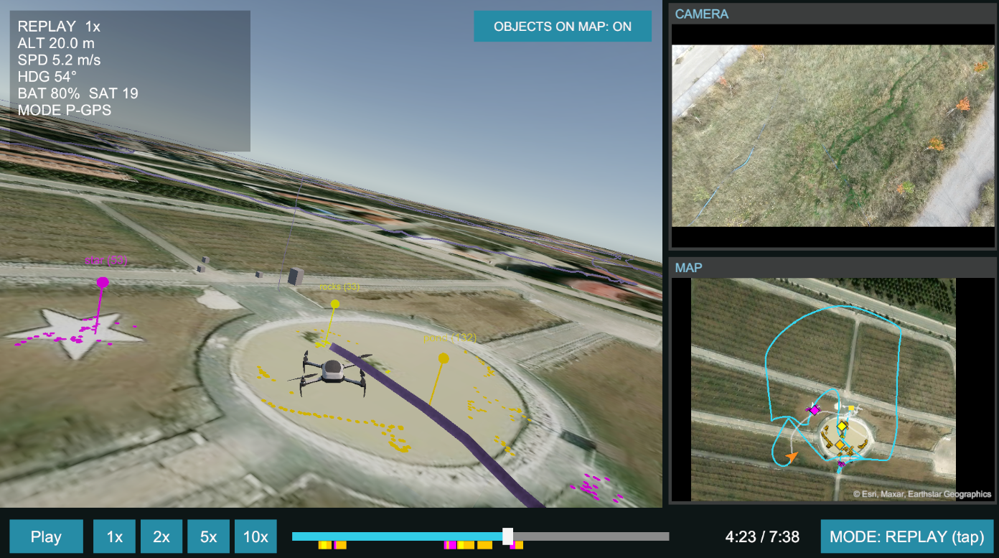
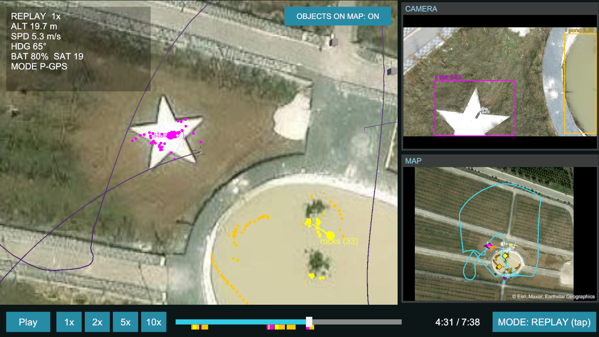
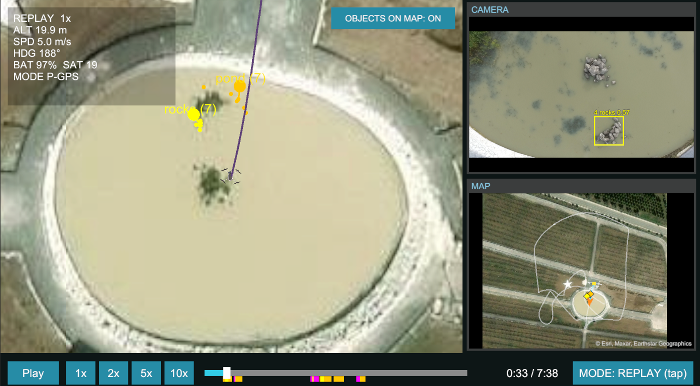

# drone-digital-twin

Digital twin of a DJI Phantom 3 Professional in Unity. A recorded flight is replayed over satellite imagery, with the camera video and a 2D map in sync on one timeline. Reference objects found in the video by a vision pipeline are shown on the video, on the timeline and, optionally, on the ground.

The detection and tracking code is not part of this repository. Unity only reads its output files.

https://github.com/user-attachments/assets/29c68ee8-d71c-4cee-96cc-a162dc0b7cdf

## Status

| Part | State |
|------|-------|
| Replay of real flights (log, video, map, 3D ground) | working, tested with our own flights |
| Reference object detection on recorded video | working; small objects and ground-level reference photos are weak |
| Detections placed on the ground | working, accuracy limited by a temporary camera calibration |
| Live link (Android app → PC → Unity) | builds, not yet tested with the drone |

## Screenshots


*Replay with OBJECTS ON MAP on. The 3D twin (left) has a pin for each detected object, at the median of its ground hits. The coloured marks under the timeline are detection runs.*


*Top-down camera. Each dot is one detection box centre projected onto the ground; the star and the rocks in the pond line up with the satellite image.*


*Early in the flight: the rocks are detected in the camera video (top right) and placed in the pond.*

## How it works

**Replay.** `FlightLog` reads the DJI flight record CSV (`*-aircraft.csv`, 10 Hz) or an Airdata CSV. Positions go into a local frame in metres (x east, y up, z north, origin at takeoff). `FlightReplayer` interpolates the drone pose for the current time. Every other view reads that same clock.

**Video sync.** The camera clock is about 12 s off, so the MP4 timestamps can't be trusted. Instead, the log's `CAMERA.isVideo` intervals are used as recording segments, and the clips in `data/videos/<flight>/` are matched to them in name order. Cross-correlating optical flow in the video with the logged speed gave an offset of -0.15 s (r = 0.93), so no correction is applied.

**Map and ground.** Esri World Imagery (or OpenStreetMap) tiles are cached under `data/tiles/`. They are drawn in the 2D map panel and laid on the 3D ground in the same local frame: zoom 19 around the track, zoom 16 out to about 800 m. The ground is flat at takeoff height.

**Detection.** The team's Task 3 pipeline (DINOv2 ViT-S/14 patch matching plus a KCF tracker, not included here) runs over each clip offline. It writes `data/detections/<flight>/detections_<clip>.json` as `{"video", "fps", "w", "h", "packets": [...]}`, with one packet per frame in the format of section 3 of [docs/protocol.md](docs/protocol.md) and `ts` in milliseconds from the start of the clip. In Unity, `VideoDetections` draws the boxes over the video and turns detection runs into clickable marks under the timeline.

**Geolocation (optional, OBJECTS ON MAP button).** Each box centre is cast as a ray from the camera, using the logged position, gimbal pitch/yaw and the intrinsics in `config/cameras/`. The ray is intersected with the ground plane, and each object is pinned at the median of its hits. The focal length (1035 px, HFOV 85.7°) was estimated from a nadir flight: image speed = f · ground speed / height. It will be replaced by a checkerboard calibration.

**Live mode.** An Android app on DJI Mobile SDK 4.18 streams telemetry (UDP :5005) and 640×360 JPEG frames (:5006) from the phone on the remote controller. `python/live_detect_track.py` tracks the object and sends results to Unity (:5007). Packet formats are in [docs/protocol.md](docs/protocol.md).

## Layout

```
unity/     Unity 6000.6.6f1 (URP) project, scene Assets/Scenes/DigitalTwin
python/    live_detect_track.py, telemetry_sender.py
android/   DJI Mobile SDK 4.18 bridge app
config/    camera intrinsics
docs/      UDP packet formats
data/      flight logs, videos, detections, tile cache (local only, not in git)
```

## Running a replay

1. Open `unity/` in Unity Hub, then the `DigitalTwin` scene.
2. Put the flight log in `data/flight_logs/` and its videos in `data/videos/<log name without -aircraft>/`. Set the log path in `DroneRoot > FlightReplayer > Csv Path`, relative to `unity/`.
3. Press Play. Click in the 3D view to switch cameras. Use the bottom bar for play, speed and seeking.

Without real data, `Assets/Data/test_flight.csv` is a generated 15-minute flight (**Tools → Generate Fake Flight CSV**).

The drone model is not in the repo because of its licence. Without it the scene shows a missing prefab, but everything else works.

## Detection results

Unity loads `data/detections/<flight>/detections_*.json` automatically. Any detector that writes this format can be used.

What we found on the test flights: top-down references (cropped from drone or satellite images) work much better than photos taken on the ground. Objects that cover only a few of DINOv2's 32×32 patches (input resized to 448×448) are often missed.

## Android app

Requirements: Android Studio, JDK 11 (Gradle 6.7.1 / AGP 4.2.2, as in DJI's sample project) and a DJI developer App Key for the package `com.example.twinbridge`. The key goes in `android/local.properties`, which is not committed:

```
sdk.dir=C\:\\Users\\<you>\\AppData\\Local\\Android\\Sdk
dji.apiKey=<App Key>
```

Connect the phone to the remote controller, enter the PC's IP in the app and press Start.

It has to run on a real ARM phone. The SDK only ships ARM native libraries. On the x86_64 emulator the app crashes at startup in `Helper.install`, before SDK registration.

The Gradle setup and permissions follow DJI's Mobile-SDK-Android 4.18 sample. The sample's source is under the DJI EULA and was not copied.

## Testing live mode without a drone

```
pip install -r python/requirements.txt
python python/telemetry_sender.py unity/Assets/Data/test_flight.csv --loop   # fake telemetry -> :5005
python python/live_detect_track.py --source 0 --manual                       # webcam, select an object by hand
```

In Unity press Play, then MODE → LIVE. In the public version `live_detect_track.py` only has manual selection (`--manual`).

For a phone on Wi-Fi, allow the UDP ports (admin PowerShell, network profile set to Private):

```powershell
New-NetFirewallRule -DisplayName "Drone twin UDP" -Direction Inbound -Protocol UDP -LocalPort 5005,5006 -Action Allow -Profile Private
```

## Not in the repo

- Flight logs and videos (personal flight data), under `data/`
- Map tile cache (provider terms), created in `data/tiles/`
- Reference object detection and tracking code (team competition code)
- Drone model `animated_drone_with_camera_free.glb` (licence unclear). Put it back in `unity/Assets/Models/` and the scene reference is restored.
- DJI App Key

## Credits

- Task 3 detection and tracking pipeline (used for the results shown, not included): emirhaan11, TEKNOFEST team
- DINOv2: Meta AI
- Imagery: Esri World Imagery; maps © OpenStreetMap contributors
